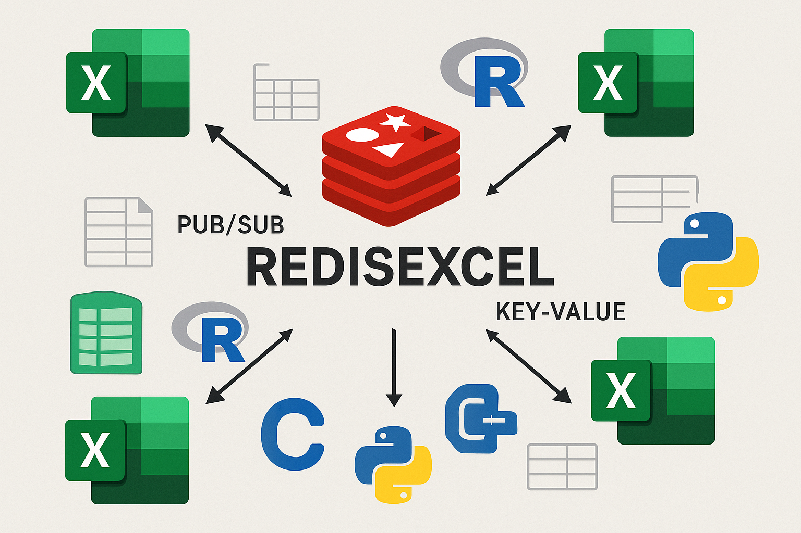

# RedisExcel



TL-DR: Read Installing in Excel and [Download Releases](https://github.com/rspadim/RedisExcel/releases)

Integration between Redis and Excel using RTD (Real-Time Data) and UDF (User Defined Functions), developed in C# (.NET Framework 4.8) with [ExcelDna](https://github.com/Excel-DNA/ExcelDna).
Supports Pub/Sub and polling with `GET`, `HGET`, `HGETALL`, `SUB`, `PSUB` commands and various UDF operations to interact with Redis.

> **New to Redis?** See the beginner guide **“No Redis server yet? Run one on Windows”** below to run a server on Windows in a couple of minutes (Docker or a native build).

---

## 🧹 Installing in Excel

### One-click install (recommended)

The easiest way for a new user: **download and run the installer**, no manual
file juggling.

1. Go to the **[latest release](https://github.com/rspadim/RedisExcel/releases/latest)**
   and, under **Assets**, click **`RedisExcelSetup-x.y.z.exe`**
   (the stable direct link is
   <https://github.com/rspadim/RedisExcel/releases/latest/download/RedisExcelSetup-1.6.0.exe>).
2. Run it and follow the wizard:
   - it copies the add-in to `C:\RedisExcel` and keeps only the XLL that matches
     your Office bitness;
   - ask it to **install a server** if you do not have one yet (Redis or Valkey
     via Docker/WSL, or Memurai) - Docker is the simplest;
   - it writes a starter `RedisExcel.json` with your host/port/password;
   - at the end it **tests the connection** and can open a sample Excel workbook
     (a live `Set`/`Get`) so you can see it working.
3. Open Excel and (if the add-in did not load by itself) enable it:
   `File > Options > Add-ins > Go... > Browse...` and pick
   `RedisExcel64-packed.xll` (or `RedisExcel-packed.xll` for 32-bit Office).

> Windows may show a SmartScreen warning because the XLL is not code-signed:
> click **More info > Run anyway**. The installer itself is a normal `.exe`.

The wizard is available in **10 languages**: English, 简体中文 (Chinese
Simplified), 繁體中文 (Chinese Traditional), Português (Brasil), Español,
Русский, Français, 한국어, Deutsch and 日本語. (Install-time only - the add-in
itself always uses **English** inside Excel, so function results and volatile
recalculation behave identically regardless of the Windows/Excel language; see
the note below.)

> **Why the add-in is English-only inside Excel:** mixing localized text into
> cell results would make volatile functions (`RedisUDFGet`, RTD cells, ...)
> return different strings depending on the machine locale, breaking spreadsheets
> that compare values or parse results. The installer is localized for usability;
> the formulas and their outputs are not.

Prefer to install by hand? Use the **Manual install** below.

#### Manual install

Keep all the add-in files in one dedicated folder, for example
`C:\RedisExcel\`. Excel loads the `.xll` from there, and it is the folder you
replace when you update the add-in.

1. Create the folder `C:\RedisExcel\` (any fixed folder works; avoid `Downloads`,
   which you may clean later).
2. Download the latest release from GitHub (`.xll`, `.dll`) - [Download Releases](https://github.com/rspadim/RedisExcel/releases)
3. Download [NLog config example files](https://github.com/rspadim/RedisExcel/blob/main/NLog.config)
4. Download [RedisExcel.json file](https://github.com/rspadim/RedisExcel/blob/main/RedisExcel.json)
5. Put the add-in files (`.xll`, `.dll`, `NLog.config`) in that same folder,
   e.g. `C:\RedisExcel\`, and put `RedisExcel.json` there too - the add-in
   folder is the FIRST place searched for it (see below).
6. In Excel: `File > Options > Add-ins`

   * Click **Go...**, then **Browse...**, and select the `.xll` file from
     `C:\RedisExcel\`
   * Match the XLL to your Office bitness: `RedisExcel-packed.xll` is 32-bit,
     `RedisExcel64-packed.xll` is 64-bit (check `File > Account > About Excel`)

> Keep the `.xll`, the `.dll` and `NLog.config` together in the same folder - the
> `.dll` is a dependency and `NLog.config` configures the log file. When you move
> the add-in, move that whole folder.

> **Upgrading from 1.5.x or older:** the configuration format changed (breaking).
> Replace the `.xll`/`.dll` as usual, then run `Validate-Config.cmd` (or
> `=RedisCheckConfigFile()` in a cell) on your existing `RedisExcel.json`: if it
> uses the old format, every cell shows a `#CONFIG` error until you migrate it.
> See **Migrating from the old shape** under the JSON configuration section.

The `RedisExcel.json` file (settings, named servers) is the host config
([Example](https://github.com/rspadim/RedisExcel/blob/main/RedisExcel.json)).
It is searched in this order (the **first existing file wins**):
>
> 1. The add-in folder (where the `.xll` lives, e.g. `C:\RedisExcel\`) - put it here to keep everything together
> 2. The user folder (`%USERPROFILE%`) - Example: `%USERPROFILE%\RedisExcel.json`
> 3. The Excel folder
> 4. Or `C:\Windows\RedisExcel.json`

> **Tip:** downloaded files may be blocked by Windows (Mark of the Web) —
> right-click each file > Properties > check **Unblock** before loading the add-in.

> **Updates:** put `=RedisUDFUpdateAvailable()` in a cell to see TRUE when a
> newer release exists. Toggle the check with `"UpdateCheck": true|false` in
> `RedisExcel.json` (default on, runs in the background and never blocks Excel).

---

## 🧰 No server yet? Run Redis, Valkey or Memurai on Windows (beginner guide)

RedisExcel speaks the Redis wire protocol, so any Redis-compatible server works:
- **Redis** and **Valkey** (the open-source fork: same commands, same port), or
- **Memurai** (a Redis-compatible **Windows service**, installed with one `.msi`).

All of them listen on `localhost:6379` by default, which is exactly what the
default `RedisExcel.json` expects. Pick one option below - the **installer**
can also set one up for you.

### Option A (recommended): Docker Desktop — Redis or Valkey

1. Install **Docker Desktop for Windows** from
   <https://www.docker.com/products/docker-desktop/> and start it (the whale icon
   in the tray turns steady). Accept the WSL2 backend when it asks.
2. Open **PowerShell** and run **one** of these (Redis or Valkey - both work):

   ```powershell
   # Redis (latest)
   docker run -d --name redis -p 6379:6379 --restart unless-stopped redis:latest
   # or Valkey (open-source fork, same protocol)
   docker run -d --name valkey -p 6379:6379 --restart unless-stopped valkey/valkey:latest
   ```

   That downloads the current image, starts it in the background, exposes it on
   `localhost:6379`, and restarts it whenever your PC reboots. (Pin a tag if you
   want reproducibility, e.g. `redis:7-alpine`.)
3. Check it is alive (use the matching name; `valkey-cli` and `redis-cli` are
   interchangeable):

   ```powershell
   docker exec redis  redis-cli  ping   # Redis
   docker exec valkey valkey-cli ping   # Valkey
   ```

   You should see `PONG`.

Handy commands later (swap `redis`/`valkey` for the name you used):

```powershell
docker stop redis      # stop it
docker start redis     # start it again
docker logs redis      # see what it is doing
docker rm -f redis     # remove it completely
```

### Option B (no Docker, one .msi): Memurai

[Memurai](https://www.memurai.com/) is a **Redis-compatible server for Windows**
that installs as a **Windows service** - no Docker, no WSL, no command line. The
free **Developer** edition is enough for local use.

1. Download Memurai from <https://www.memurai.com/get-memurai> (Developer
   edition).
2. Run the `.msi` and keep the default options. It registers a service and
   starts listening on **`localhost:6379`** automatically.
3. Verify:

   ```powershell
   & "C:\Program Files\Memurai\memurai-cli.exe" ping
   ```

   You should see `PONG`. (If the installer added `memurai-cli`/`redis-cli` to
   `PATH`, plain `redis-cli ping` works too.)

Manage it like any Windows service (admin):

```powershell
Get-Service Memurai          # status
Restart-Service Memurai      # restart
Stop-Service Memurai         # stop
```

> Memurai is commercial software (the Developer edition is free); read its
> licence before using it beyond development. RedisExcel does not bundle it - the
> installer only *points you to it* (and can try `winget install
> Memurai.MemuraiDeveloper` if you pick the Memurai option in the wizard).

### Option C: Redis or Valkey inside WSL2 (real server, no Docker)

If you already have WSL2, you run the real thing with no port quirks:

```powershell
wsl --install -d Ubuntu                                     # one time, if you have no WSL distro
wsl sudo apt update
wsl sudo apt install -y valkey-server                       # or redis-server
wsl valkey-server                                           # listens on localhost:6379
```

Or the archived Microsoft port
[redis-windows](https://github.com/tporadowski/redis/releases) - unzip and run
`redis-server.exe` (same protocol).

All options listen on `localhost:6379` by default. Verify with:

```powershell
redis-cli ping      # or valkey-cli / memurai-cli; all speak the same protocol
```

You should see `PONG`.

> Redis/Valkey are designed to run natively on Linux. On Windows, the smoothest
> paths are **Option A (Docker Desktop)**, **Option B (Memurai, one .msi)** or
> **Option C (WSL2)**. Whatever you choose, RedisExcel only needs a server that
> speaks the Redis protocol on the port you configured.

### Point Excel at another host or port

The examples in this file use the default `localhost:6379`. To use a different
server, put it in `RedisExcel.json` (set `Default` to a `Servers` name or to a
raw connection string) or pass it as the last argument of a formula, e.g.
`=RedisUDFGet("preco_btc", "192.168.0.10:6379")`. A full StackExchange.Redis
connection string works too, e.g.
`"myredis.example:6379,password=secret,ssl=true"` (its credentials are masked in
error cells and logs).

---

## 🚀 Example: Reading and publishing from Python

```python
import redis

r = redis.StrictRedis(host='localhost', port=6379, db=0)

# Set a key the sheet reads with =RedisUDFGet("preco_btc")
r.set("preco_btc", "67000.50")

# Publish to a channel that feeds =RedisUDFChannelLatest("canal_alerta")
# or =RTD("RedisRtd", , "SUB", "canal_alerta")
r.publish("canal_alerta", "ALTA")

# Read a key the sheet wrote with =RedisUDFSet("preco_btc", ...)
print(r.get("preco_btc"))

# Subscribe to what the sheet publishes with =RedisUDFChannelPublish("canal_alerta", ...)
pubsub = r.pubsub()
pubsub.subscribe("canal_alerta")
for message in pubsub.listen():
    print(message)
```

---

## 🚀 Example: Publishing from Excel (send data)

```Excel
=RedisUDFSet("preco_btc", "67000.50")                          // send SET message (key-value database)
=RedisUDFSetNonVolatile("preco_btc", "67000.50")               // same as Set, but sent only once (not on every recalc)
=RedisUDFChannelPublish("canal_alerta", "ALTA")                // send PUB/SUB message
=RedisUDFChannelPublishJSON("range_of_data", A1:C20)           // send PUB/SUB Matrix, encoded as JSON
```

---

## 🚀 Example: Subscribe and UDF from Excel (fetch data)

```Excel
=RedisUDFGet("preco_btc")                                      // receive GET (key-value database) with UDF (no character limit)
=RTD("RedisRtd", , "GET", "canal_alerta")                      // receive GET (key-value database - automatic pooling) with RTD (max of 255 characters)
=RedisUDFChannelLatest("canal_alerta")                         // receive PUB/SUB with UDF (no character limit)
=RTD("RedisRtd", , "SUB", "canal_alerta")                      // receive PUB/SUB with RTD (max of 255 characters)
=RedisUDFJSONToMatrix(RedisUDFChannelLatest("range_of_data"))  // receive PUB/SUB Matrix using UDF (no RTD)
```

---

## 🛠️ Build Instructions

### Requirements

* Visual Studio 2022+
* .NET Framework 4.8
* NuGet packages:

  * ExcelDna.AddIn
  * ExcelDna.Integration
  * ExcelDna.IntelliSense
  * StackExchange.Redis
  * NLog
  * Newtonsoft.Json

### Steps

```bash
git clone https://github.com/rspadim/RedisExcel.git
```

1. Open the project in Visual Studio
2. Restore NuGet packages
3. Build in `Release` mode — the `.xll` files are generated in `bin\Release\net48\publish`

### Tests

* Unit tests (no Redis/Excel): `dotnet test test\RedisExcel.Tests\RedisExcel.Tests.csproj -c Release`
* Smoke tests (Redis only): `dotnet run --project test\SmokeTests -c Release -- "localhost:6379"`
* Excel end-to-end: `powershell -ExecutionPolicy Bypass -File test\Run-ExcelE2E.ps1`

See [AGENTS.md](AGENTS.md) and [test/README.md](test/README.md) for details,
including the Excel automation troubleshooting notes (antivirus/EDR and COM
registration).

---

## 🔎 Excel Examples

### Pub/Sub

```excel
=RTD("RedisRtd", , "SUB", "canal_alerta", "localhost:6379")
=RTD("RedisRtd", , "SUB", "canal_alerta", "dev") // can find an alias using `RedisExcel.json` file
=RTD("RedisRtd", , "SUB", "canal_alerta")  // uses default host if omitted
```

> **Message order is not guaranteed**: StackExchange.Redis dispatches every
> `SUB`/`PSUB` handler on the thread pool, so two messages can be delivered out
> of order when they are in flight at the same time (common in a fast feed,
> rare at a slow one). Nothing is lost and nothing stalls - the delivery
> continues - but a cell remembers the last value that finished delivering, so
> a burst can transiently leave an older value (until the next message). Feeds
> that care about order should carry a timestamp/sequence field in the payload
> and compare it in the formula (or read with a polled `GET`/`HGET`, which is
> one round trip, single-threaded per host).

You can find other connection string formats in the [StackExchange.Redis configuration manual](https://stackexchange.github.io/StackExchange.Redis/Configuration).

---

## 📊 Available RTD Functions

| Function                    | Description                            | 
| --------------------------- | -------------------------------------- | 
| RedisRTDConnectionCount     | Number of live Redis connections (RTD only; UDF excluded) | 
| RedisRTDSubscriptionCount   | Active subscriptions (RTD only; UDF excluded) | 
| RedisRTDTopicCount          | Total number of RTD topics registered  | 
| RedisRTDChannelCount        | Distinct subscribed channels (RTD only) | 
| RedisRTDDefaultHost         | Current default Redis host             | 
| RedisRTDExcelUpdateInterval | Excel update interval (ms)             | 
| RedisRTDRedisUpdateInterval | Redis polling interval (ms)            | 
| RedisRTDRealTimeUpdates     | Is real-time update enabled? (bool)    | 
| RedisRTDMessagesCounter     | Messages received in the last full second | 

---

## RTD Parameters Reference

When calling the Excel RTD function like this:

```excel
=RTD("RedisRtd", , param1, param2, param3, param4)
```

Each parameter has a specific meaning depending on the RTD command.

### RTD Parameters Breakdown

| Param  | Description                                               |
| ------ | --------------------------------------------------------- |
| param1 | Command: GET, HGET, HGETALL, SUB, PSUB                    |
| param2 | Key, hash, or channel name                                |
| param3 | Host (optional for GET/HGETALL/SUB/PSUB), or field (HGET) |
| param4 | Host (only used in HGET if param3 is the field name)      |

> If `param3` or `param4` are omitted, the default host will be used. You can use aliases from your `RedisExcel.json`.

### Supported RTD Commands

| Command | Description                      | Arguments            |
| ------- | -------------------------------- | -------------------- |
| GET     | Polls a Redis key                | key, \[host]         |
| HGET    | Polls a field in a Redis hash    | hash, field, \[host] |
| HGETALL | Polls all fields in a Redis hash; a missing hash returns `{}` | hash, \[host]        |
| SUB     | Subscribes to a Redis channel    | channel, \[host]     |
| PSUB    | Subscribes to a Redis pattern    | pattern, \[host]     |

> All commands support specifying either a full connection string or a named host defined in the `RedisExcel.json` file.

> A `SUB`/`PSUB` topic that cannot subscribe at connect time shows `#ERROR`
> and is retried with a 1s..30s backoff, capped per tick; polled commands
> (`GET`/`HGET`/`HGETALL`) retry on every tick. Editing the formula
> re-registers the topic as well.

## 💡 Available UDF Functions

Functions to use directly in Excel cells:

> **⚠️ Volatile by design:** every RedisExcel function that accesses Redis is
> volatile, so it recalculates on every edit and on `F9`. That is what keeps
> read functions fresh - and it means write functions re-execute on every
> recalculation too: `Set`, `SetJSON`, `SetKV`/`SetKVPair`, `SetEx`, `Expire`,
> `Incr`, `IncrBy`, `Rename`, `Del`, hash/list/set writers, channel publishes
> and unsubscribe all run again each time. For example, `=RedisUDFIncr("k")`
> increments the counter every time the sheet recalculates, not once. Use
> manual calculation (Formulas > Calculation Options > Manual) when that
> matters, keep write calls on a sheet you update deliberately, or use the
> non-volatile twins below. One exception to the re-execution rule: with
> `AsyncWrites: true`, the recalculation that delivers an async write's result
> returns the cached value for the same registered call instead of re-running
> the write (best-effort while the internal topic stays connected - see the
> `AsyncWrites` section below). `RedisUDFChannelPublishIfChanged` guards
> itself: it only publishes when the payload changed since the last delivery.
> The two JSON conversion helpers (`RedisUDFMatrixToJSON` and
> `RedisUDFJSONToMatrix`) are
> non-volatile: they are pure conversions with no `IsVolatile` flag and
> recalculate only when their inputs change.
>
> **🧊 NonVolatile write twins (24):** every write function has an additive
> `...NonVolatile` twin with the same arguments and behavior. Excel evaluates
> the twin only when the formula is entered and when one of its argument cells
> changes - `F9` and cell edits do not re-run it. `Ctrl+Alt+F9` (full
> recalculation) still re-runs it, like it does for every function. Reads stay
> volatile only (there are no read twins: `Get`, `HashGet`, `ChannelLatest`,
> ... must refresh by themselves). The 24 twins are
> `RedisUDFSetNonVolatile`, `RedisUDFSetExNonVolatile`,
> `RedisUDFDelNonVolatile`, `RedisUDFExpireNonVolatile`,
> `RedisUDFIncrNonVolatile`, `RedisUDFIncrByNonVolatile`,
> `RedisUDFRenameNonVolatile`, `RedisUDFSetJSONNonVolatile`,
> `RedisUDFSetKVNonVolatile`, `RedisUDFSetKVPairNonVolatile`,
> `RedisUDFHashSetNonVolatile`, `RedisUDFHashSetMultipleNonVolatile`,
> `RedisUDFHashDelNonVolatile`, `RedisUDFListPushRightNonVolatile`,
> `RedisUDFListPushLeftNonVolatile`, `RedisUDFListPopRightNonVolatile`,
> `RedisUDFListPopLeftNonVolatile`, `RedisUDFSetAddNonVolatile`,
> `RedisUDFSetRemoveNonVolatile`, `RedisUDFChannelPublishNonVolatile`,
> `RedisUDFChannelPublishJSONNonVolatile`,
> `RedisUDFChannelPublishIfChangedNonVolatile`,
> `RedisUDFChannelPublishIfChangedJSONNonVolatile` and
> `RedisUDFChannelUnsubscribeNonVolatile`.
> Example: `=RedisUDFSetNonVolatile("k", A1)` sends the pair when it is entered
> and again whenever `A1` changes, but not when the sheet recalculates.

| Function                         | Description                      | Parameters                                |
| -------------------------------- | -------------------------------- | ----------------------------------------- |
| RedisUDFGet                      | Get the value of a key           | key, optionalHost                         |
| RedisUDFSet                      | Set the value of a key           | key, value, optionalHost                  |
| RedisUDFSetJSON                  | Set JSON-encoded data            | key, matrix, optionalHost                 |
| RedisUDFSetKV / SetKVPair        | Set key-value pairs              | keys, values / pairs, optionalHost        |
| RedisUDFGetMultiple              | Get multiple keys                | keys\[], multipleColumnsOpt, optionalHost |
| RedisUDFType                     | Get the key type                 | key, optionalHost                         |
| RedisUDFRename                   | Rename a key                     | key, newKey, optionalHost                 |
| RedisUDFExists / ExistsMultiples | Check key existence              | key / keys\[], optionalHost               |
| RedisUDFTTL / TTLMultiples       | Time-to-live (TTL) for keys      | key / keys\[], optionalHost               |
| RedisUDFSetEx                    | Set a key with a TTL             | key, value, ttlSeconds, optionalHost      |
| RedisUDFExpire                   | Set a TTL on a key               | key, ttlSeconds, optionalHost             |
| RedisUDFDel                      | Delete a key (returns deleted count) | key, optionalHost                     |
| RedisUDFIncr / RedisUDFIncrBy    | Atomic counters                  | key, optionalHost / key, increment, optionalHost |
| RedisUDFHashSet                  | Set a field in a hash            | hashKey, field, value, optionalHost       |
| RedisUDFHashSetMultiple          | Set multiple hash fields         | hashKey, fieldValuePairs (2 columns), optionalHost |
| RedisUDFHashGet                  | Get a field from a hash          | hashKey, field, optionalHost              |
| RedisUDFHashGetAll               | Get all fields of a hash (2-column matrix; empty cell when missing) | hashKey, optionalHost |
| RedisUDFHashGetFieldMultipleKeys | Get one field from multiple hashes (one row per key; errors stay per row) | hashKeys, field, optionalHost |
| RedisUDFHashDel                  | Delete a hash field              | hashKey, field, optionalHost              |
| RedisUDFListPushRight / Left     | Push to a list (returns length)  | key, value, optionalHost                  |
| RedisUDFListRange                | Get a range of list elements     | key, start, stop, optionalHost            |
| RedisUDFListPopRight / Left      | Pop a list element               | key, optionalHost                         |
| RedisUDFSetAdd                   | Add a member to a set (returns added count) | key, value, optionalHost        |
| RedisUDFSetMembers               | Get all members of a set         | key, optionalHost                         |
| RedisUDFSetRemove                | Remove a set member              | key, value, optionalHost                  |
| RedisUDFChannelPublish/...       | Pub/Sub operations               | channel, message, optionalHost            |
| RedisUDFChannelLatest            | Latest Pub/Sub message (subscribes on first use) | channel, optionalHost       |
| RedisUDFChannelUnsubscribe       | Unsubscribe a channel | channel, optionalHost   |
| RedisUDFPubSubChannelsInfo       | Lists active Pub/Sub channels and subscriber counts | optionalHost             |
| RedisUDFUpdateAvailable       | TRUE when a newer release exists | none                                      |
| RedisCheckConfigFile          | Validate RedisExcel.json against its schema | optionalFilePath (blank = the config in use) |
| RedisJsonSchemaContents       | The JSON Schema used to validate RedisExcel.json | none                              |
| RedisUDFJSONToMatrix             | Convert JSON → Excel matrix      | json, nullValue                           |
| RedisUDFMatrixToJSON             | Convert Excel matrix → JSON      | matrix                                    |
| RedisUDFServerTime               | Redis server current time        | optionalHost                              |
| RedisUDFKeys                     | List keys by pattern (SCAN); invalid pageSize values fall back to the default | pattern, optionalHost, pageSize |
| RedisUDFConnectionCount          | Number of live UDF connections   | None                                      |
| RedisUDF...NonVolatile (24)      | Non-volatile twins of the write functions (same arguments): run on entry and when an argument cell changes, not on `F9`/edits - see the `NonVolatile` note above | same as the original function |

> **Cell values:** date/time cells are stored as their Excel serial number (use
> `TEXT()` for a date string) and boolean cells as `true`/`false` (the JSON
> path does the same).

> **Missing values:** the sentinel differs per function family. `RedisUDFGet`,
> `RedisUDFHashGet` and the list pops return an empty cell; `RedisUDFGetMultiple`
> and `RedisUDFChannelLatest` return `(null)`; RTD `GET`/`HGET` return
> `(no value)` while RTD `HGETALL` returns `{}` for a missing hash;
> `RedisUDFHashGetAll`, `RedisUDFKeys`, `RedisUDFSetMembers` and
> `RedisUDFListRange` return an empty cell when there is nothing to show;
> `RedisUDFTTL` returns `-1` and `RedisUDFExists` returns `0` for a missing key.

> **Blank keys:** `RedisUDFGetMultiple` skips blank, empty and whitespace-only
> key cells (the other multi-key functions keep one row per input).

> **ChannelLatest after unsubscribe:** `RedisUDFChannelLatest` is best-effort
> right after `RedisUDFChannelUnsubscribe` - `UNSUBSCRIBE` is fire-and-forget,
> so a rapid unsubscribe/re-subscribe can deliver an in-flight message once.

---

## 🔁 Function return values

What each cell shows for the common outcomes. "matrix" means the function
spills a 2-column range; a missing key/value uses the sentinel noted per group.

### Reads

| Function | Found | Missing key/value |
| --- | --- | --- |
| `RedisUDFGet` | the string value | empty cell |
| `RedisUDFType` | `string` / `list` / `set` / `zset` / `hash` / `stream` | `none` |
| `RedisUDFExists` | `1` | `0` |
| `RedisUDFTTL` | seconds; `-1` when the key exists but has no expiry | `-1` (StackExchange.Redis maps both Redis `-1` and `-2` to null) |
| `RedisUDFKeys` | matrix (pattern matches, SCAN) | empty cell when there is no match |
| `RedisUDFGetMultiple` | matrix (one row per key) | `(null)` per blank/missing cell |
| `RedisUDFHashGet` | the field value | empty cell |
| `RedisUDFHashGetAll` | matrix of field/value pairs | empty cell (a missing hash is not an error) |
| `RedisUDFHashGetFieldMultipleKeys` | matrix (one row per hash key) | per-row `Error:`/empty cell, never the whole matrix |
| `RedisUDFSetMembers` | matrix (one member per row) | empty cell when empty |
| `RedisUDFListRange` | matrix (one element per row) | empty cell when the range is empty |
| `RedisUDFListPopRight` / `Left` | the popped element | empty cell when the list is empty |
| `RedisUDFChannelLatest` | the latest message (subscribes on first use) | `(null)` before the first message |
| `RedisUDFPubSubChannelsInfo` | matrix `Channel` / `Subscribers` (header first) | header-only matrix when nothing is subscribed |
| `RedisUDFServerTime` | the server time | - |
| `RedisUDFUpdateAvailable` | `TRUE` when a newer release is known (background check, never blocks) | `FALSE` |
| `RedisCheckConfigFile` | `OK (...)` when the config is valid, otherwise one line per problem | `Error: ...` (never blocks) |
| `RedisJsonSchemaContents` | the JSON Schema text (the allowed keys/values) | - |
| `RedisUDFConnectionCount` | live UDF connections | `0` |
| `RedisUDFMatrixToJSON` / `RedisUDFJSONToMatrix` | the converted text / matrix | `Error:` cell on bad input |

### Writes

| Outcome | Cell |
| --- | --- |
| Synchronous write (`SyncWrite: "sync"`) | the real reply: `OK`, the integer result (e.g. `1`), the deleted/added count, etc. |
| Reply-agnostic write sent fire-and-forget (`SyncWrite: "fireforget"`/`"fireforget-all"`) | `OK (fire and forget)` |
| Reply-dependent write forced fire-and-forget (`SyncWrite: "fireforget-all"`) | `OK (fire and forget: all)` |
| Publish (`RedisUDFChannelPublish`, reply awaited) | `N reader` / `N readers` (`0 readers` when none) |
| Publish suppressed (`RedisUDFChannelPublishIfChanged`, unchanged payload) | `No change` (`No Readers` when the channel has no subscriber) |

### Errors

| Kind | Cell |
| --- | --- |
| Invalid argument (blank key/field/channel, bad range shape, bad ttl, ...) | `Error: <short message>` (stable, e.g. `Error: a key is required`) |
| Runtime/connection failure | `Error: <identifiers>: <cause> | <hint>` (verbose, e.g. host unreachable, timeout, `WRONGTYPE`); the function name is in the log, not the cell |

> In the fire-and-forget modes an error detected **after** the command is
> dispatched (or a delivery failure) is only logged, and the cell keeps the
> marker - the markers mean the write was sent, not confirmed by Redis.
> Validation and host/config failures **before** the dispatch still surface as
> an `Error:` cell. Matrix functions report per-row `Error:` cells for the rows
> that failed instead of discarding the whole matrix.

> **Credentials are never shown:** when the `host` argument is a full connection
> string, its `password`/`pass`/`user`/`username` values are masked (`****`) in
> every error cell and log line (`RedisRTDDefaultHost` masks too); the host,
> port and options stay readable. The masking also covers the spellings
> StackExchange.Redis accepts (whitespace around `=`, quoted values).

---

## 📝 Configuration Files

### Example: NLog.config

```xml
<?xml version="1.0" encoding="utf-8" ?>
<nlog xmlns="http://www.nlog-project.org/schemas/NLog.xsd"
      xmlns:xsi="http://www.w3.org/2001/XMLSchema-instance">

  <targets>
    <target name="file" xsi:type="File"
            fileName="RedisExcel.log"
            layout="${longdate}|${level:uppercase=true}|${logger}|${message} ${exception:format=toString}"
            archiveFileName="RedisExcel.{#}.log"
            archiveAboveSize="104857600"
            archiveNumbering="Rolling"
            maxArchiveFiles="5"
            keepFileOpen="true"
            encoding="utf-8" />
  </targets>

  <rules>
    <logger name="*" minlevel="Debug" writeTo="file" />
  </rules>
</nlog>
```

### JSON Configuration (RedisExcel.json)

The server is declared **once**. `Default` names a server from `Servers` (or is
a raw connection string); `Servers` values may be a connection string or an
object with per-server timeouts.

```json
{
  "Default": "local",
  "Timeout": { "connectTimeout": 5000, "syncTimeout": 5000 },
  "Servers": {
    "local": "localhost:6379,defaultDatabase=0,ssl=False,abortConnect=False",
    "prod": { "host": "sentinel-a:26379,sentinel-b:26379,serviceName=mymaster", "connectTimeout": 8000, "syncTimeout": 8000 },
    "cache": "node-a:6379,node-b:6379"
  },
  "RTD": {
    "RedisUpdateRateMs": 1000,
    "ExcelUpdateRateMs": 100,
    "MessageCounterThreshold": 10000,
    "ExcelUpdateStyle": "Automatic",
    "UseGetMultiple": true,
    "CoalesceRealtimeUpdates": true
  },
  "UpdateCheck": true,
  "SkipRepeatedMessages": true,
  "ConflationMs": 200,
  "PublishDedupCacheSize": 10000,
  "SyncWrite": "fireforget",
  "AsyncWrites": false
}
```

> **Migrating from the old shape:** the previous `RTD.host` / `UDF.host` /
> `RTD.timeout` / `UDF.timeout` and the top-level `CoalesceRealtimeUpdates` were
> **removed**. Move the host(s) into `Servers`, point `Default` at one (or put a
> raw connection string in `Default`), move the timeouts into
> `Timeout`/the server object, and move `CoalesceRealtimeUpdates` inside `RTD`. A
> file that still uses the old keys is **rejected**: every cell shows `#CONFIG`
> until it is fixed. Use `=RedisCheckConfigFile()` / `Validate-Config.cmd` to see
> exactly what is wrong.

> **Config notes:** the file is read once per Excel process - restart Excel
> after editing it. The first existing file wins (the add-in folder, then the
> user profile, the Excel folder and `C:\Windows`); a file that exists but is
> rejected stops the search (no fall-through to a lower-priority file). When
> **no config file is found at all**, `ExcelUpdateRateMs` falls back to `1000`
> ms (a loaded file uses `100` ms unless it sets the key explicitly).
> `PublishDedupCacheSize` (default `10000`) caps the LRU cache used by
> `RedisUDFChannelPublishIfChanged` to remember the last payload published per
> host/channel. `ConflationMs` (unset by default) is the real-time delivery
> window described in the table below; while a topic keeps changing Excel is
> updated at most once per window with the latest value, which is the main
> lever against screen flicker and the recalculation cascade on fast feeds.

> **Comments & validation:** the file may contain `//` and `/* */` comments. A
> wrong value on a **known** key (e.g. `"RedisUpdateRateMs": "x"` or a bad
> `ExcelUpdateStyle`) makes the add-in **reject the whole file**: every cell shows
> `#CONFIG: ...` (no silent fallback) until you fix it and restart Excel. An
> **extra/unknown** key (one the add-in does not use) is only a **warning** in the
> log. Put `=RedisCheckConfigFile()` in a cell to validate the configuration in
> use, or `=RedisCheckConfigFile("C:\\path\\RedisExcel.json")` for a specific
> file: it returns `OK (...)` or one line per problem without needing the log.
> `=RedisJsonSchemaContents()` returns the JSON Schema itself (the allowed keys
> and values), validated with NJsonSchema against the schema shipped in the XLL.

#### Other JSON keys

Keys in the sample above, with their code defaults:

| Key | Default | Effect |
| --- | ------- | ------ |
| `Default` | the built-in host | The server used by RTD and UDF: a name defined in `Servers`, or a raw connection string (used as-is). |
| `Servers` | `{}` | Named servers: `name -> "connection string"` or `name -> { "host": "...", "connectTimeout": ms, "syncTimeout": ms }`. |
| `Timeout` | `5000` / `5000` | Global defaults (ms) for servers declared as a plain string: `connectTimeout` (handshake/AUTH) and `syncTimeout` (reply wait). |
| `SkipRepeatedMessages` | `true` | Skips identical consecutive payloads before decoding/delivering for literal `SUB` and `GET`/`HGET` polling (unchanged `HGETALL` hashes too). Patterns (`PSUB`) are never deduplicated because channels interleave. Set it to `false` for feeds that republish the same value as a liveness signal. |
| `ConflationMs` | *(unset)* | Explicit real-time conflation window in milliseconds: while a topic keeps changing, Excel is updated at most once per window with the latest value (`0` = off, one push per message; capped at 3600000). When unset, `RTD.CoalesceRealtimeUpdates` decides. A window below ~50-100 ms barely helps because the flush rides the Excel tick. |
| `RTD.MessageCounterThreshold` | `10000` | `Automatic` `ExcelUpdateStyle` burst threshold: above this many messages in the last second, real-time delivery is disabled and the Excel tick flushes dirty values; the 1s tick re-enables it when the rate drops. `<= 0` disables the switch. |
| `RTD.CoalesceRealtimeUpdates` | `true` | In real-time mode, sends at most one update per topic per `ExcelUpdateRateMs` window (the latest value wins) instead of one Excel update per incoming message. `false` restores per-message delivery. Superseded by an explicit `ConflationMs`. (Lives inside `RTD`.) |
| `RTD.ExcelUpdateStyle` | `"Automatic"` | `Automatic`, `Timer` or `Realtime`. `Timer` never pushes per message (only the Excel tick flushes); `Realtime` always pushes; `Automatic` starts real-time and switches at the threshold. An undefined/unknown value falls back to `Automatic`. |
| `RTD.UseGetMultiple` | `true` | Batches RTD `GET` topics of a host into a single `MGET` per polling tick. `false` polls each `GET` key in the per-host pipeline with `HGET`/`HGETALL` instead. |

### Write Behavior (`SyncWrite` / `AsyncWrites`)

These keys control how UDF writes reach Redis; the `...NonVolatile` twins use
the same write path. Like the rest of the file they are read once per Excel
process. `SyncWrite` is case-insensitive; unknown or blank values fall back to
`fireforget`.

| Key | Default | Values | Effect |
| --- | ------- | ------ | ------ |
| `SyncWrite` | `"fireforget"` | `"sync"`, `"fireforget"`, `"fireforget-all"` | How a write waits for the Redis reply (modes below). |
| `AsyncWrites` | `false` | `true` / `false` | Where a write runs: on the Excel calculation thread (`false`) or through a per-host serial queue (`true`; queued items run on thread-pool threads, but no thread is held while an item is queued). |

`SyncWrite` modes:

- `"sync"` - every write blocks until Redis replies and the cell shows the real
  result or error.
- `"fireforget"` (default) - result-agnostic writes (`Set`, `SetJSON`,
  `SetKV`/`SetKVPair`, `SetEx`, `Rename`, `HashSet`, `HashSetMultiple`, list
  pushes and channel publishes) are sent with FireAndForget and return the
  marker `OK (fire and forget)`; reply-dependent writes (`Del`, `Incr`, `IncrBy`,
  `Expire`, `SetAdd`, `SetRemove`, `HashDel` and the list pops) still block and
  return their real result. `RedisUDFChannelUnsubscribe` never uses the
  fire-and-forget path: it removes the local listeners deterministically and
  returns its own result.
- `"fireforget-all"` - every write uses FireAndForget (except
  `RedisUDFChannelUnsubscribe`, which always completes its listener
  bookkeeping): result-agnostic writes return `OK (fire and forget)`,
  reply-dependent writes return `OK (fire and forget: all)`.

In the fire-and-forget modes the reply is discarded by StackExchange.Redis: a
write the server rejects (WRONGTYPE, OOM, quota) is neither awaited nor detected,
so the cell keeps the marker and nothing is logged for it. Only validation and
host/config failures before the dispatch surface as `Error:`. A publish returns
the marker instead of `N readers`
(`RedisUDFChannelPublishIfChanged` reports `No change` when the payload was
suppressed; in the fire-and-forget modes its dedup marker is recorded without
a confirmed delivery, so an external subscriber joining later may miss an
unchanged payload until it changes). The markers mean the write was sent, not
confirmed by Redis - use `SyncWrite: "sync"` when a write must be confirmed.

`AsyncWrites: true` dispatches writes through Excel-DNA's Observe-based async
support instead of the Excel calculation thread (no thread-pool thread is held
per pending write): the cell first shows Excel's pending marker (`#N/A`) and
then updates to the real value/error (or the fire-and-forget marker). While
the internal RTD topic stays connected, each formula writes exactly once - the
recalculation that delivers the result returns the cached value (the call
identity is the cell plus the resolved host plus the formula's arguments)
instead of re-running the write. A duplicate async registration (a defensive
path; Excel-DNA normally registers once per call) never re-enqueues the write
and still receives the queued result. When Excel instead detaches the topic
(for
example an unchanged recalculation), the next evaluation re-registers the call
and a volatile write is issued again: the dedup is best-effort, not
exactly-once across the sheet lifetime. A write whose host cannot be resolved
falls back to the synchronous path (no pending marker); a write with no
worksheet caller (e.g. invoked from a macro) is refused with an `Error:` cell.
Same-host writes are serialized by a per-host FIFO queue fed on the Excel
thread (other hosts are not blocked), so the order is the formula evaluation
order. `SyncWrite` still decides whether that write waits for the reply - so
`"sync"` + `AsyncWrites: true` returns real results and errors without
blocking Excel.

---

## ♻️ Force Update in Excel

* Press `F9` (this re-runs the volatile functions; the `...NonVolatile` twins
  only re-run on a full recalculation, `Ctrl+Alt+F9`)
* Or use VBA:

```vba
Dim nextUpdate As Date

Sub RefreshRTD()
    Sheet1.Calculate
    nextUpdate = Now + TimeValue("00:00:01")
    Application.OnTime nextUpdate, "RefreshRTD"
End Sub

Sub StopUpdate()
    On Error Resume Next
    Application.OnTime nextUpdate, "RefreshRTD", , False
End Sub
```

---

## 📬 Contact

Open an *issue* on GitHub or email as instructed in the repository.
